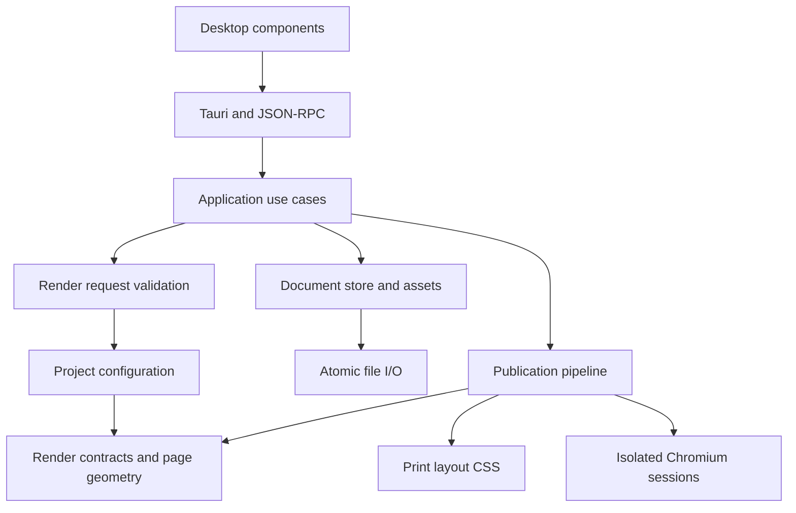

# Engineering guide

This is the development contract for Mardas Folio. User-facing behavior belongs in
the two [user guides](./README.md); release operations belong in
[Maintenance](./MAINTENANCE.md). Prefer a small, testable change to an existing
boundary over introducing a new framework or duplicating behavior.

## Ownership and dependencies

| Boundary | Owns | Does not own |
| --- | --- | --- |
| `document_store.py` | Bounded UTF-8 reads, revisions, BOM/newline preservation, conflict-aware saves | Rendering, RPC, project discovery |
| `file_io.py` | Temporary allocation, exact bytes, permission preservation, atomic replacement, cleanup | Extension rules, conflict policy, application errors |
| `document_assets.py` | Bounded discovery, safe asset names, anchored create-only imports | Editor state or native dialogs |
| `request_validation.py` | Request shape, scalar types, UTF-8 and NUL checks | Filesystem work or rendering |
| `render_requests.py` | Request overrides, project defaults, path normalization, option-schema parity | Transport envelopes or UI state |
| `render_contracts.py` / `page_geometry.py` | Publication option types, shared exceptions, validated physical page sizes | Markdown parsing or Chromium imports |
| `print_layout.py` / `assets/print-layout.css` | Dynamic print variables and static publication layout rules | Browser sessions or application requests |
| `application.py` | Use-case orchestration and stable public facade | Low-level file commit mechanics |
| `sidecar.py` / `protocol.py` | JSON-RPC, bounded requests, one active job, cancellation, stdout discipline | Widgets or file-dialog policy |
| `renderer.py` / `markdown.py` | Publication pipeline, rendering and document semantics | Desktop window state |
| `src-tauri/src` | Native dialogs, process lifecycle, local grants, updater boundary | Reimplementation of publishing logic |
| `frontend/js/core` | Reusable state, schemas, adapters and request policy | Importing the application entrypoint |
| `frontend/js/ui` | DOM components, focus, event lifecycle, injected host callbacks | Native bridge calls hidden inside a control |
| `frontend/js/main.mjs` | Composition and cross-feature orchestration | New independent feature implementations |

`application` re-exports its existing document and option APIs. Move implementation
without forcing every CLI/sidecar consumer to migrate. Leaf modules must not import
their orchestrator; `test_engine_boundaries.py` checks this architectural constraint.
`renderer` similarly re-exports publication types and page helpers. Importing
configuration or request resolution must not load Markdown, PDF or browser runtimes;
fresh-process tests verify the transitive dependency boundary.
Keep dependencies explicit in imports and component constructor arguments. Avoid
runtime import tricks, generic service locators, and unrelated catch-all utilities.



## Files, errors and asynchronous work

- Validate untrusted parameters before scans, allocations, or writes. Reject a
  boolean where an integer is required. Preserve the distinction between an omitted
  option, `false`, and an explicit value.
- Preserve stable application error codes at the transport boundary. Keep unexpected
  exception details in diagnostic logs, not ordinary user-facing messages.
- The writer flushes a sibling temporary file, runs the caller's final revision
  check, and replaces the destination. It returns metadata from the actual written
  file. Do not reread the destination to construct the save response.
- `FILE_WRITE_LOCK` coordinates this process. Revision checks reduce external edit
  races; they are not a cross-process filesystem compare-and-swap transaction.
  Directory syncing is best effort on platforms that do not support it.
- Cancellation and exceptional exits must release descriptors, browser contexts,
  threads, listeners, and temporary files. A context manager or fixture teardown
  should own every resource whose lifetime spans more than one statement.
- Every asynchronous UI result must still belong to the initiating document or
  control when it arrives. A native path-picker result cannot update a control that
  was replaced by a different preset or category.
- Optimize a measured bottleneck. Reuse existing encoded bytes when saving, bound
  scans and queues, and preserve isolated browser contexts. Do not introduce caches
  without an invalidation policy and tests.

## Interface and design system

`frontend/design/tokens.css` owns semantic colors, typography, spacing, and sizing.
`design/components.css` owns shared controls. Feature styles own layout. New UI
colors must use the existing `--ui-*` roles. Publication palette swatches are an
intentional exception: their values must match `appearance.PALETTES`.
Publication layout is separate: edit native CSS in `assets/print-layout.css`;
`print_layout.py` only composes option-dependent page rules and CSS variables.

Use one shared interaction implementation for controls with the same semantics.
`ui/radio-group.mjs` supplies roving focus and directional keys to both tri-state
toggles and palette swatches. Include an explicit inherit choice rather than making
a checked radio silently toggle itself off. Preserve focus when rebuilding controls;
test both RTL and LTR. Associate validation messages with their inputs.

DOM components take native actions and error presentation as callbacks. They expose
a small lifecycle (`render`, feature actions, `destroy`), own their draft state,
and must not mutate a request merely because they were displayed or translated.
Watch for synchronous `blur`/`change` reentry when replacing a focused control.

## Tests and fixtures

Use the cheapest test that proves the behavior, with integration coverage where a
boundary matters:

1. Node and Python tests cover domain rules, request contracts and state transitions.
2. Temporary real files cover save conflicts, encodings, permissions, imports,
   failure cleanup, and concurrent writes. Mock a failure at the I/O boundary,
   keeping the rest of the operation real.
3. Chromium component tests cover actual DOM events, keyboard focus, disabled
   controls, native-picker races, and localized UI. They use production HTML/CSS
   and modules, with only the native boundary substituted.
4. Existing desktop browser audits and real PDF tests cover composition and the
   publishing pipeline. Native Rust tests cover process and IPC behavior. Platform
   packaging and installed-app validation remain separate release checks.

Fixtures must be small, explicit and isolated. `tests/conftest.py` offers an engine
whose session is always closed and a document factory with explicit BOM/newline
choices. `tests/browser/conftest.py` shares only the browser and HTTP server; each
case gets a fresh browser context. `apps/desktop/tests/fixtures/tauri.mjs` restores
the previous native bridge in `t.after`, including after failed assertions. Do not
hide scenario-specific assertions in a fixture or use global autouse state.

Prefer assertions on returned values, files and visible behavior over regular
expressions matching implementation source. Source contracts still suit fixed
security settings and asset manifests. Do not increase tests by repeating the
same implementation in the expected result. Use deterministic coordination
(events, barriers, controlled promises) instead of sleep-based race tests.

## Local verification

Activate the project virtual environment first. Pyright receives that interpreter
explicitly so the type check uses the same dependencies as the tests.

```bash
source .venv/bin/activate
bash scripts/check.sh -q
npm --prefix apps/desktop test
npm --prefix apps/desktop run check:editor
bash scripts/check_critical_coverage.sh

# Browser tests opt in explicitly; failure to launch is an error when enabled.
MARDAS_BROWSER_TESTS=1 PYTEST_DISABLE_PLUGIN_AUTOLOAD=1 python -m pytest -q tests/browser

python scripts/build_desktop_frontend.py
python scripts/verify_desktop_frontend.py apps/desktop/dist
python scripts/audit_export_layout.py
python scripts/audit_desktop_documents.py
cargo test --manifest-path apps/desktop/src-tauri/Cargo.toml --locked
```

The default Python suite skips browser and optional rendering cases; a green
default run does not replace them. CI explicitly enables the component browser
suite after installing Chromium. Critical coverage includes extracted services;
moving a function must not remove it from type or coverage checks. Do not raise
coverage by excluding error paths or counting only easy functions.

## References and how they apply

- [pytest fixtures](https://docs.pytest.org/en/stable/how-to/fixtures.html): explicit
  dependencies, appropriately scoped setup and reliable cleanup.
- [Practical Test Pyramid](https://martinfowler.com/articles/practical-test-pyramid.html):
  balance fast behavioral tests with targeted integration and UI evidence.
- [Python filesystem APIs](https://docs.python.org/3/library/os.html#os.replace):
  replacement, file-descriptor and platform semantics underpin the shared writer.
- [WAI-ARIA radio groups](https://www.w3.org/WAI/ARIA/apg/patterns/radio/) and
  [modal dialogs](https://www.w3.org/WAI/ARIA/apg/patterns/dialog-modal/): test real
  keyboard and focus behavior alongside semantic attributes.
- [W3C form labels](https://www.w3.org/WAI/WCAG22/Techniques/html/H44): explicit
  `label for` associations are valid names and must be recognized by static audits.
- [Playwright isolation](https://playwright.dev/python/docs/browser-contexts): isolate
  browser state for each test rather than repairing it between scenarios.
- [Geist foundations](https://vercel.com/geist/introduction): the reference used by
  the current interface; local semantic tokens remain this product's source of truth.
