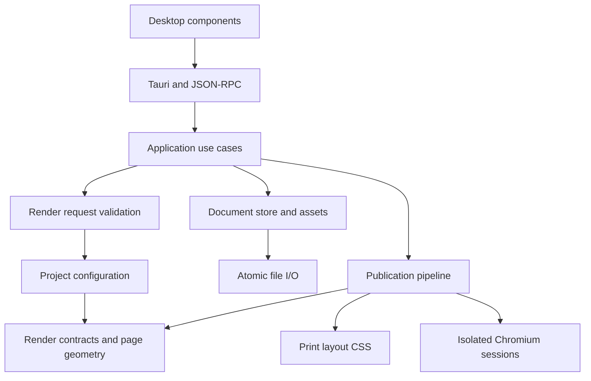

# Engineering guide

This is the development contract for Mardas Folio. User-facing behavior belongs in
the two [user guides](./README.md); release operations belong in
[Maintenance](./MAINTENANCE.md). Prefer a small, testable change to an existing
boundary over introducing a new framework or duplicating behavior.

## Ownership and dependencies

| Boundary | Responsibility |
| --- | --- |
| `markup/` | Front matter, BiDi/text isolation, math protection and code-block transformations; `markdown.py` orders the semantic pipeline and preserves imports |
| `publishing/` | HTML/cover composition, thread-affine Chromium sessions, quality checks, PDF metadata/navigation and atomic publication; `renderer.py` preserves the API and orchestrates conversion |
| `projects/` | Workspace models, bounded discovery/search, revision-aware file I/O, loading/validation and transactional book mutations; `workspace.py` preserves imports and composes previews/exports |
| `document_store.py`, `document_assets.py` | Document encoding/revisions/conflicts and bounded, anchored asset operations |
| `file_io.py` | Shared exact-byte writes, permissions, atomic replacement and cleanup |
| `request_validation.py`, `render_requests.py` | Request shape, options/defaults and path normalization; no transport or widget state |
| `render_contracts.py`, `page_geometry.py`, `print_layout.py` | Publication types, shared errors, physical page rules and static print CSS |
| `application.py`, `sidecar.py`, `protocol.py` | Use cases and stable facades, bounded JSON-RPC, job lifecycle/cancellation and stdout discipline |
| `apps/desktop/src-tauri/src/` | Native dialogs, process lifecycle, local file grants and updater; no publishing reimplementation |
| `frontend/js/core/` | Shared models, analysis, request/state policies; no feature/UI/native-command imports |
| `frontend/js/adapters/` | Native commands, RPC payloads and storage access |
| `frontend/js/features/` | Documents/tabs/persistence, book creation/chapters/operations, export, settings/updater and workspace panes |
| `frontend/js/ui/` | Shared DOM components, focus, keyboard interactions and notifications with injected callbacks |
| `frontend/js/preview/` | Safe document content, sanitization, page layout, online-image controls and math |
| `frontend/js/main.mjs` | Composition, cross-feature coordination and remaining project/book workflows; new independent behavior belongs with its feature |
| `editor-src/` | CodeMirror extensions; generated bundle in `frontend/js/vendor/` |
| `scripts/`, `scripts/lib/` | Stable command entrypoints and reusable `audit/` / `build/` libraries |
| `tests/engine/`, `tests/desktop/`, `tests/tooling/`, `tests/browser/` | Engine behavior, native/frontend contracts, developer tools and real-browser integration |
| `apps/desktop/tests/` | Node suites grouped by `core/`, `adapters/`, `features/`, `ui/`, `editor/`; shared native fixtures in `fixtures/` |
| `docs/reviews/` | Historical evidence; this file is the current engineering standard |

`application` re-exports its existing document and option APIs. Move implementation
without forcing every CLI/sidecar consumer to migrate. Leaf modules must not import
their orchestrator; `test_engine_boundaries.py` checks this architectural constraint.
`renderer` similarly re-exports publication types and page helpers. Importing
configuration or request resolution must not load Markdown, PDF or browser runtimes;
fresh-process tests verify the transitive dependency boundary.
Keep dependencies explicit in imports and component constructor arguments. Avoid
runtime import tricks, generic service locators, and unrelated catch-all utilities.



## Naming and source organization

- Python uses `snake_case` for modules/functions/fields, `PascalCase` for classes
  and exceptions, and `UPPER_SNAKE_CASE` for constants. Private helpers start with
  `_`; public facades explicitly re-export existing symbols.
- JavaScript filenames use `kebab-case.mjs`, functions/locals use `camelCase`,
  classes use `PascalCase`, and fixed shared constants use `UPPER_SNAKE_CASE`.
  Rust follows rustfmt and the standard snake-case / PascalCase conventions.
- Names describe domain responsibility. Include units when otherwise ambiguous
  (`timeout_ms`, `maxBytes`), keep established terms such as document, chapter,
  workspace and publication, and avoid generic `utils`, redundant class prefixes
  or duplicate abbreviations.
- Prefer imports, constants/contracts, then related API/helper groups. Group by
  responsibility rather than splitting every helper into its own file.
- `.editorconfig` defines UTF-8/LF and indentation. Pinned Ruff owns Python
  formatting/import order; pinned Prettier owns authored desktop JS/CSS; rustfmt
  owns Rust. ESLint checks undeclared/unused names and frontend import boundaries.
- Do not format generated bundles, vendor code, lockfiles, semantic Markdown
  fixtures or embedded publication HTML/CSS strings. Rebuild the editor bundle
  with `npm --prefix apps/desktop run build:editor` when its authored inputs change.

## Compatibility and extending the project

Add semantic transformations to `markup/` and call them in the existing pipeline
order. Add publication behavior to the corresponding `publishing/` owner.
Project I/O and mutations belong in `projects/`; CLI commands call those services.
Implementation packages must not import their legacy facade or transport entrypoint;
the architecture tests enforce that direction.

Feature controllers take explicit callbacks for cross-feature actions and receive
the existing application state where workflows share ownership. They must not import
`main.mjs`. Core policies remain reusable; optional locale storage in `core/i18n.mjs`
is the existing persistence boundary, not permission to put native commands in core.
Use the native/storage adapters for environment access and inject native actions
into shared UI components. Book creation owns its modal request lifetime;
book operations own save preparation, the exclusive task guard, cancellation
handoff, validation, review and output. They receive document saving and project
application as callbacks. Keep task factories lazy: claiming the guard must precede
any picker, confirmation or save.

Preserve CLI names, Python compatibility imports, JSON-RPC schemas, Tauri commands,
storage keys/recovery payloads, installation identifiers and emitted `md2pdf-*`
HTML/CSS names. Internal moves are not a reason to rename these contracts.
Keep the old facade when moving implementation. Update imports, build inventories,
tests and CI paths in the same batch.

New tests belong beside their owning suite. Use `tests/_paths.py` for Python
repository paths; do not derive the root from a test's directory depth. Node's
`scripts/test.mjs` discovers suites recursively and works without shell globbing.
Move an existing suite only after comparing collected test identities.

## Files, errors and asynchronous work

- Validate untrusted parameters before scans, allocations, or writes. Reject a
  boolean where an integer is required. Preserve the distinction between an omitted
  option, `false`, and an explicit value.
- Preserve stable application error codes at the transport boundary. Keep unexpected
  exception details in diagnostic logs, not ordinary user-facing messages.
- The writer flushes a sibling temporary file, runs the caller's final revision
  check, and replaces the destination. It returns metadata from the actual written
  file. Do not reread the destination to construct the save response.
- `FILE_WRITE_LOCK` coordinates this process. Revision checks reduce external edit
  races; they are not a cross-process filesystem compare-and-swap transaction.
  Directory syncing is best effort on platforms that do not support it.
- Cancellation and exceptional exits must release descriptors, browser contexts,
  threads, listeners, and temporary files. A context manager or fixture teardown
  should own every resource whose lifetime spans more than one statement.
- Every asynchronous UI result must still belong to the initiating document or
  control when it arrives. A native path-picker result cannot update a control that
  was replaced by a different preset or category.
- Optimize a measured bottleneck. Reuse existing encoded bytes when saving, bound
  scans and queues, and preserve isolated browser contexts. Do not introduce caches
  without an invalidation policy and tests.

## Interface and design system

`frontend/design/tokens.css` owns semantic colors, typography, spacing, and sizing.
`design/components.css` owns shared controls. `frontend/styles/` owns shell and feature layout. `index.html` is the explicit
cascade order; preserve both stylesheet order and computed styles when moving CSS.
Existing `editing-polish.css` and related layered sheets retain their order. Add
rules to the responsible sheet rather than appending another override stylesheet. New UI
colors must use the existing `--ui-*` roles. Publication palette swatches are an
intentional exception: their values must match `appearance.PALETTES`.
Publication layout is separate: edit native CSS in `assets/print-layout.css`;
`print_layout.py` only composes option-dependent page rules and CSS variables.

Use one shared interaction implementation for controls with the same semantics.
`ui/radio-group.mjs` supplies roving focus and directional keys to both tri-state
toggles and palette swatches. Include an explicit inherit choice rather than making
a checked radio silently toggle itself off. Preserve focus when rebuilding controls;
test both RTL and LTR. Associate validation messages with their inputs.

DOM components take native actions and error presentation as callbacks. They expose
a small lifecycle (`render`, feature actions, `destroy`), own their draft state,
and must not mutate a request merely because they were displayed or translated.
Watch for synchronous `blur`/`change` reentry when replacing a focused control.

## Tests and fixtures

Use the cheapest test that proves the behavior, with integration coverage where a
boundary matters:

1. Node and Python tests cover domain rules, request contracts and state transitions.
2. Temporary real files cover save conflicts, encodings, permissions, imports,
   failure cleanup, and concurrent writes. Mock a failure at the I/O boundary,
   keeping the rest of the operation real.
3. Chromium component tests cover actual DOM events, keyboard focus, disabled
   controls, native-picker races, and localized UI. They use production HTML/CSS
   and modules, with only the native boundary substituted.
4. Existing desktop browser audits and real PDF tests cover composition and the
   publishing pipeline. Native Rust tests cover process and IPC behavior. Platform
   packaging and installed-app validation remain separate release checks.

Fixtures must be small, explicit and isolated. `tests/conftest.py` offers an engine
whose session is always closed and a document factory with explicit BOM/newline
choices. `tests/browser/conftest.py` shares only the browser and HTTP server; each
case gets a fresh browser context. `apps/desktop/tests/fixtures/tauri.mjs` restores
the previous native bridge in `t.after`, including after failed assertions. Do not
hide scenario-specific assertions in a fixture or use global autouse state.

Prefer assertions on returned values, files and visible behavior over regular
expressions matching implementation source. Source contracts still suit fixed
security settings and asset manifests. Do not increase tests by repeating the
same implementation in the expected result. Use deterministic coordination
(events, barriers, controlled promises) instead of sleep-based race tests.

## Local verification

Activate the project virtual environment first. Pyright receives that interpreter
explicitly so the type check uses the same dependencies as the tests.

```bash
source .venv/bin/activate
bash scripts/check.sh -q
npm --prefix apps/desktop run lint
npm --prefix apps/desktop run format:check
npm --prefix apps/desktop test
npm --prefix apps/desktop run check:editor
bash scripts/check_critical_coverage.sh

# Browser tests opt in explicitly; failure to launch is an error when enabled.
MARDAS_BROWSER_TESTS=1 PYTEST_DISABLE_PLUGIN_AUTOLOAD=1 python -m pytest -q tests/browser

python scripts/build_desktop_frontend.py
python scripts/verify_desktop_frontend.py apps/desktop/dist
python scripts/audit_export_layout.py
python scripts/audit_desktop_documents.py
cargo fmt --manifest-path apps/desktop/src-tauri/Cargo.toml --check
cargo test --manifest-path apps/desktop/src-tauri/Cargo.toml --locked
```

The default Python suite skips browser and optional rendering cases; a green
default run does not replace them. CI explicitly enables the component browser
suite after installing Chromium. Critical coverage includes extracted services;
moving a function must not remove it from type or coverage checks. Do not raise
coverage by excluding error paths or counting only easy functions.

## References and how they apply

- [pytest fixtures](https://docs.pytest.org/en/stable/how-to/fixtures.html): explicit
  dependencies, appropriately scoped setup and reliable cleanup.
- [Practical Test Pyramid](https://martinfowler.com/articles/practical-test-pyramid.html):
  balance fast behavioral tests with targeted integration and UI evidence.
- [Python filesystem APIs](https://docs.python.org/3/library/os.html#os.replace):
  replacement, file-descriptor and platform semantics underpin the shared writer.
- [WAI-ARIA radio groups](https://www.w3.org/WAI/ARIA/apg/patterns/radio/) and
  [modal dialogs](https://www.w3.org/WAI/ARIA/apg/patterns/dialog-modal/): test real
  keyboard and focus behavior alongside semantic attributes.
- [W3C form labels](https://www.w3.org/WAI/WCAG22/Techniques/html/H44): explicit
  `label for` associations are valid names and must be recognized by static audits.
- [Playwright isolation](https://playwright.dev/python/docs/browser-contexts): isolate
  browser state for each test rather than repairing it between scenarios.
- [Geist foundations](https://vercel.com/geist/introduction): the reference used by
  the current interface; local semantic tokens remain this product's source of truth.

Formatting-only changes belong in their own commit. Run targeted suites after
structural changes and the broader engine/desktop/browser/rendering checks at the
integration milestone. Packaging checks must inspect the wheel's modules/resources,
not rely solely on editable imports. Known baseline failures must remain visible.

Build outputs and caches are not source. Reuse the existing environments and build
caches. Keep QA artifacts under `build/`, remove disposable outputs from your own
runs after recording results, and never include installed applications, user
settings, documents or recovery profiles in repository cleanup.

Tool configuration references: [Ruff](https://docs.astral.sh/ruff/formatter/),
[Prettier options](https://prettier.io/docs/options), and
[ESLint configuration](https://eslint.org/docs/latest/use/configure/configuration-files).
