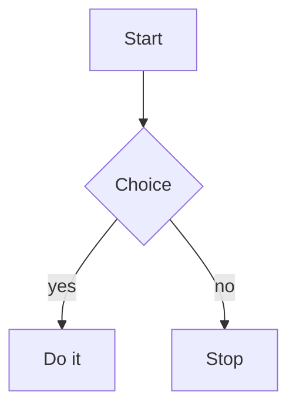

# Heading one

## Heading two

### Heading three

#### Heading four

##### Heading five

###### Heading six

Setext heading one
==================

Setext heading two
------------------

Paragraph with **bold**, *italic*, ***bold italic***, ~~strikethrough~~,
`inline code`, and a [link](https://example.com "Title text").

Reference link: [reference][ref] and collapsed [ref][].

[ref]: https://example.com/reference "Reference title"

Autolink <https://example.com/auto> and a bare URL https://example.com/bare
and an email <someone@example.com>.

Escapes: \*not emphasis\*, \_not italic\_, \`not code\`, and a backslash \\.

Hard break at the end of this line  
lands here. Backslash break\
lands here too.

Entities: &amp; &copy; &mdash; &#8594;

- Unordered item
- Another item
  - Nested item
    - Deeper item
- Item with a very long line that should wrap and hang under its own text rather than restarting beneath the bullet marker itself

1. Ordered item
2. Second item
   1. Nested ordered
   2. Second nested
7. Ordered list starting at seven

- [ ] Unchecked task
- [x] Checked task
- [X] Capital checked task

Term list:

Term
: Definition of the term

> A blockquote.
>
> With a second paragraph.
>
> > And a nested quote.

> [!NOTE]
> A note callout.

> [!WARNING]
> A warning callout.

> [!TIP]
> A tip callout.

> [!IMPORTANT]
> An important callout.

> [!CAUTION]
> A caution callout.

---

***

___

| Left | Center | Right |
| :--- | :----: | ----: |
| a    | b      | c     |
| longer cell | with more text | 42 |

```python
def render(document: str) -> bytes:
    """Fenced code with a language."""
    return chromium.print_to_pdf(document)
```

```
Fenced code with no language.
```

~~~js
// Tilde fence
const x = 1;
~~~

    Indented code block
    second line

```python title="listing.py" showLineNumbers
def titled():
    return "fence attributes"
```



Inline math $E = mc^2$ inside a sentence, and $\alpha + \beta$ too.

Not math: it cost $5 and $7 total.

$$
\int_0^\infty e^{-x^2}\,dx = \frac{\sqrt{\pi}}{2}
$$

A footnote reference[^1] and another[^long].

[^1]: The first footnote body.
[^long]: A longer footnote body that
    continues on an indented line.


<div class="raw-html">
  <strong>Raw HTML block</strong> with <em>inline</em> children.
</div>

Inline <abbr title="HyperText Markup Language">HTML</abbr> and <br> a break.

متن فارسی با **پررنگ** و *مورب* و `کد` و [پیوند](https://example.com).

- مورد اول فهرست
- مورد دوم فهرست

> نقل‌قول فارسی که باید از راست به چپ خوانده شود.

| ستون اول | ستون دوم |
| -------- | -------- |
| مقدار    | مقدار    |

Mixed direction: این یک خط است that mixes Persian and English در یک خط.
